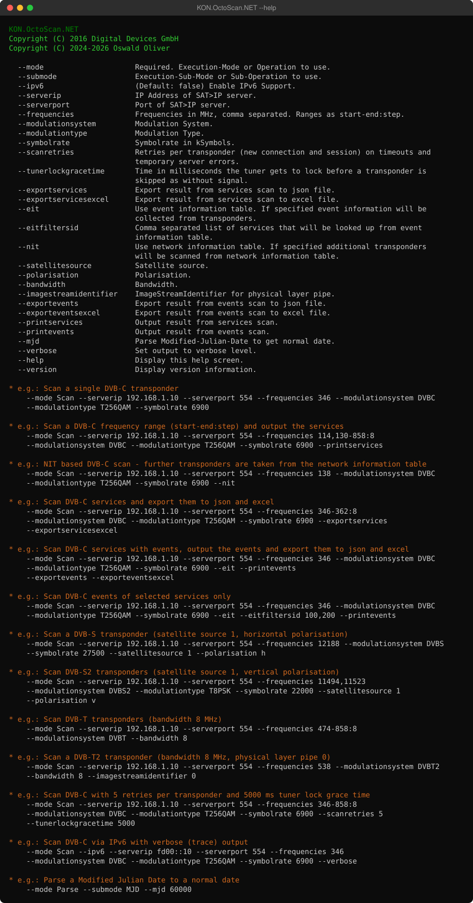

# KON.OctoScan.NET
.NET Port of octoscan (from DigitalDevices)

## Usage



<details>
<summary>Help as text</summary>

```text
KON.OctoScan.NET
Copyright (C) 2016 Digital Devices GmbH
Copyright (C) 2024-2026 Oswald Oliver

  --mode                     Required. Execution-Mode or Operation to use.
  --submode                  Execution-Sub-Mode or Sub-Operation to use.
  --ipv6                     (Default: false) Enable IPv6 Support.
  --serverip                 IP Address of SAT>IP server.
  --serverport               Port of SAT>IP server.
  --frequencies              Frequencies in MHz, comma separated. Ranges as start-end:step.
  --modulationsystem         Modulation System.
  --modulationtype           Modulation Type.
  --symbolrate               Symbolrate in kSymbols.
  --scanretries              Retries per transponder (new connection and session) on timeouts and
                             temporary server errors.
  --tunerlockgracetime       Time in milliseconds the tuner gets to lock before a transponder is
                             skipped as without signal.
  --exportservices           Export result from services scan to json file.
  --exportservicesexcel      Export result from services scan to excel file.
  --eit                      Use event information table. If specified event information will be
                             collected from transponders.
  --eitfiltersid             Comma separated list of services that will be looked up from event
                             information table.
  --nit                      Use network information table. If specified additional transponders
                             will be scanned from network information table.
  --satellitesource          Satellite source.
  --polarisation             Polarisation.
  --bandwidth                Bandwidth.
  --imagestreamidentifier    ImageStreamIdentifier for physical layer pipe.
  --exportevents             Export result from events scan to json file.
  --exporteventsexcel        Export result from events scan to excel file.
  --printservices            Output result from services scan.
  --printevents              Output result from events scan.
  --mjd                      Parse Modified-Julian-Date to get normal date.
  --verbose                  Set output to verbose level.
  --help                     Display this help screen.
  --version                  Display version information.

* e.g.: Scan a single DVB-C transponder
    --mode Scan --serverip 192.168.1.10 --serverport 554 --frequencies 346 --modulationsystem DVBC
    --modulationtype T256QAM --symbolrate 6900

* e.g.: Scan a DVB-C frequency range (start-end:step) and output the services
    --mode Scan --serverip 192.168.1.10 --serverport 554 --frequencies 114,130-858:8
    --modulationsystem DVBC --modulationtype T256QAM --symbolrate 6900 --printservices

* e.g.: NIT based DVB-C scan - further transponders are taken from the network information table
    --mode Scan --serverip 192.168.1.10 --serverport 554 --frequencies 138 --modulationsystem DVBC
    --modulationtype T256QAM --symbolrate 6900 --nit

* e.g.: Scan DVB-C services and export them to json and excel
    --mode Scan --serverip 192.168.1.10 --serverport 554 --frequencies 346-362:8
    --modulationsystem DVBC --modulationtype T256QAM --symbolrate 6900 --exportservices
    --exportservicesexcel

* e.g.: Scan DVB-C services with events, output the events and export them to json and excel
    --mode Scan --serverip 192.168.1.10 --serverport 554 --frequencies 346 --modulationsystem DVBC
    --modulationtype T256QAM --symbolrate 6900 --eit --printevents
    --exportevents --exporteventsexcel

* e.g.: Scan DVB-C events of selected services only
    --mode Scan --serverip 192.168.1.10 --serverport 554 --frequencies 346 --modulationsystem DVBC
    --modulationtype T256QAM --symbolrate 6900 --eit --eitfiltersid 100,200 --printevents

* e.g.: Scan a DVB-S transponder (satellite source 1, horizontal polarisation)
    --mode Scan --serverip 192.168.1.10 --serverport 554 --frequencies 12188 --modulationsystem DVBS
    --modulationtype TQPSK --symbolrate 27500 --satellitesource 1 --polarisation h

* e.g.: Scan DVB-S2 transponders (satellite source 1, vertical polarisation)
    --mode Scan --serverip 192.168.1.10 --serverport 554 --frequencies 11494,11523
    --modulationsystem DVBS2 --modulationtype T8PSK --symbolrate 22000 --satellitesource 1
    --polarisation v

* e.g.: Scan DVB-T transponders (bandwidth 8 MHz)
    --mode Scan --serverip 192.168.1.10 --serverport 554 --frequencies 474-858:8
    --modulationsystem DVBT --bandwidth 8

* e.g.: Scan a DVB-T2 transponder (bandwidth 8 MHz, physical layer pipe 0)
    --mode Scan --serverip 192.168.1.10 --serverport 554 --frequencies 538 --modulationsystem DVBT2
    --bandwidth 8 --imagestreamidentifier 0

* e.g.: Scan DVB-C with 5 retries per transponder and 5000 ms tuner lock grace time
    --mode Scan --serverip 192.168.1.10 --serverport 554 --frequencies 346-858:8
    --modulationsystem DVBC --modulationtype T256QAM --symbolrate 6900 --scanretries 5
    --tunerlockgracetime 5000

* e.g.: Scan DVB-C via IPv6 with verbose (trace) output
    --mode Scan --ipv6 --serverip fd00::10 --serverport 554 --frequencies 346
    --modulationsystem DVBC --modulationtype T256QAM --symbolrate 6900 --verbose

* e.g.: Parse a Modified Julian Date to a normal date
    --mode Parse --submode MJD --mjd 60000
```

</details>
